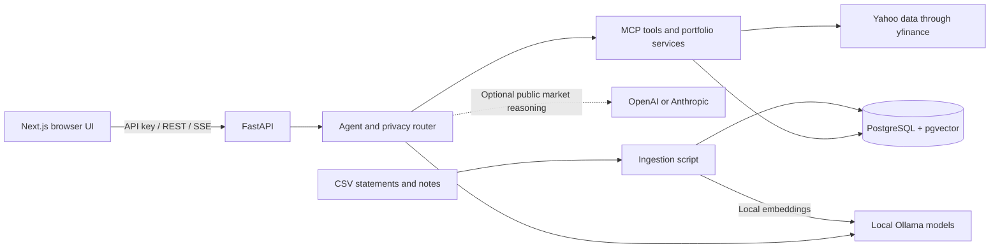

# FinBrain

FinBrain is a self-hosted personal finance assistant and paper trading workspace.
Chat with your financial records, inspect source citations and tool activity,
and test stock trades with virtual money. A new portfolio starts with
**$100,000 in virtual cash**.

The dashboard includes balances and P&L, timestamped orders, stock quotes,
candlestick/volume charts, SMA 50/200 and RSI 14.

## Simple architecture



- **Next.js** displays chat, live tool checkpoints, sources and the dashboard.
- **FastAPI** authenticates requests and coordinates the agent and services.
- **Ollama** generates local answers and financial document embeddings.
- **PostgreSQL** stores financial chunks, conversations and the virtual ledger.
- **yfinance** supplies stock quotes and daily price history.
- **Optional cloud models** receive approved public market context when enabled.

Personal financial context uses local inference. Paper orders update cash,
positions and receipts atomically in PostgreSQL.

## Which key goes where?

| Setting | Location | Purpose |
| --- | --- | --- |
| `API_KEY` | Root `.env`, then paste the same value into the browser sidebar | Access to your FinBrain backend |
| `POSTGRES_PASSWORD` | Root `.env` | Database administrator password |
| `APP_DB_PASSWORD` | Root `.env` | Application database password |
| `LLM_CLOUD_API_KEY` | Root `.env`, optional | OpenAI or Anthropic cloud reasoning |
| `NEXT_PUBLIC_API_BASE_URL` | `frontend/.env.local` | Backend address, normally `http://127.0.0.1:8000` |

The setup script generates the FinBrain key and database passwords. Ollama and
the current yfinance integration require no personal provider API key. Cloud
provider keys stay in the backend environment. The browser retains the FinBrain
key in tab memory.

## Run the project

You need Docker Desktop with its Linux engine running, Python 3.11+, Node.js 22+
and Ollama. These PowerShell instructions run the Python backend in Docker and
the Next.js frontend on your laptop. Run commands from the repository root
unless a step changes directories.

### 1. Get the code and create configuration

```powershell
git clone https://github.com/tarundhiman85/Fin-Brain.git
cd Fin-Brain
py setup_env.py
```

If you already have the repository, open its existing folder. Run `setup_env.py`
only when creating a new `.env`; it refuses to overwrite an existing file.
On systems without the Windows Python launcher, use `python3 setup_env.py`.

### 2. Prepare local AI models

Start Ollama, then download the embedding and chat models.

```powershell
ollama pull nomic-embed-text:latest
ollama pull qwen2.5-coder:7b
```

Create a local alias with a 16K context window for multi-step tool calls.

```powershell
New-Item -ItemType Directory -Force data/private | Out-Null
$modelConfig = @('FROM qwen2.5-coder:7b', 'PARAMETER num_ctx 16384')
$modelConfig | Set-Content -Encoding utf8 data/private/FinBrain.Modelfile
ollama create finbrain-local -f data/private/FinBrain.Modelfile
```

Edit these values in the root `.env`.

```dotenv
LLM_LOCAL_MODEL=finbrain-local:latest
LLM_ROUTING_MODE=auto
LLM_CLOUD_ENABLED=false
LLM_OFFLINE_MODE=false
EMBEDDING_MODEL=nomic-embed-text:latest
```

Keep Ollama running. If its desktop service is not active, start `ollama serve`
in another terminal. The Docker API connects to the host Ollama service through
`host.docker.internal:11434` on Docker Desktop.

`LLM_OFFLINE_MODE=false` enables market data and new paper orders. Setting it to
`true` allows local financial queries and ledger reads while disabling market
access. For Ollama's own cloud-disable settings, see the [routing guide](README_Phase4.md).

### 3. Initialize the database and load sample data

```powershell
docker compose up -d --wait postgres
docker compose --profile app build api
docker compose --profile app run --rm api python database.py
docker compose --profile app run --rm api python upgrade_phase2.py
docker compose --profile app run --rm api python upgrade_phase3.py
docker compose --profile app run --rm api python ingest_finance.py --csv data/sample_transactions.csv --notes data/sample_notes.txt
```

The database persists in the Compose `postgres_data` volume. Initialization
creates the application database role, enables pgvector and seeds the virtual
portfolio. The sample transactions and notes are fictional. Repeating an
unchanged import skips existing chunks.

For an existing database, retain its configured embedding model identity.
Changing `.env` database passwords does not rotate existing database roles.

### 4. Start the backend

```powershell
docker compose --profile app up -d api
docker compose --profile app ps
```

Open **http://127.0.0.1:8000/docs** to inspect the API. Click **Authorize** and
enter `API_KEY` from your root `.env` to test protected routes.

### 5. Start the frontend

Open a second terminal in the repository root.

```powershell
cd frontend
Copy-Item .env.example .env.local
npm ci
npm run dev
```

Copy the frontend environment template only when creating `.env.local`.
Open **http://127.0.0.1:3000**, paste the root `.env` value of `API_KEY` into the
sidebar, and click **Connect securely**.

The default browser origins are localhost and 127.0.0.1 on port 3000. For other
ports, update frontend `NEXT_PUBLIC_API_BASE_URL` and backend `UI_ORIGINS`, then
restart the affected services.

### 6. Try chat and paper trading

Choose **Local only** and start with a portfolio check.

```text
Check my virtual cash balance and paper holdings. Do not execute any trades.
```

Ask a question about your ingested financial records.

```text
Find my grocery transactions and cite the financial document chunks.
```

To place a capped virtual order, send the following request.

```text
Check AAPL's quote and my virtual cash. Buy 1 paper share only if its price
and total cost are at most $500. Enforce max_buy_price=500 and
max_notional=500. Report the confirmed order receipt.
```

Wait for a confirmed receipt. Open **Trading dashboard**, refresh the portfolio,
and inspect its holdings and Order ledger. Click a ticker to view its chart and
toggle SMA/RSI. Add approved symbols through Market watch.

Market prices may be delayed. Quotes and orders include source timestamps, and
unavailable or stale quotes can prevent fills. Check AI answers against tool
observations and citations. Semantic search alone does not establish a complete
statement total.

## Everyday startup and shutdown

After the first setup, start Docker Desktop and Ollama, then run the following
from the repository root.

```powershell
docker compose --profile app up -d postgres api
cd frontend
npm run dev
```

Press Ctrl+C in the frontend terminal to stop it. From the repository root,
stop the Compose services while keeping the database volume with the following.

```powershell
docker compose --profile app down
```

For the previously created laptop demo, start `finbrain-demo-db` and
`finbrain-demo-api` using `docker start` instead of starting another backend on
port 8000. Those containers have their own database and credentials. Their
FinBrain key can differ from the root `.env` used by Compose.

## Your own data and optional cloud models

CSV files use `Date,Description,Amount,Category`, ISO dates and plain decimal
amounts with up to two decimal places. Negative amounts represent expenses and
positive amounts represent income or refunds. Notes are UTF-8 text files.

Private files under `data/private/` are excluded from the backend image. To
import a normalized `data/private/statement.csv`, mount that directory read-only
for the import command, run from the repository root.

```powershell
docker compose --profile app run --rm --volume "${PWD}/data/private:/imports:ro" api python ingest_finance.py --csv /imports/statement.csv
```

Add `--notes /imports/notes.txt` for a text file in the same folder. File identity
includes its absolute path and row location, so moving or reordering an input
may create new chunks. Keep the project, personal records, credentials and
backups outside cloud-sync folders. Git ignores do not prevent OneDrive
synchronization. The [UI guide](README_Phase6_UI.md) also documents host Python
execution.

For optional cloud market reasoning, set the following in root `.env`, then
recreate the API service with `docker compose --profile app up -d api`.

```dotenv
LLM_CLOUD_ENABLED=true
LLM_CLOUD_PROVIDER=openai
LLM_CLOUD_MODEL=<model available in your account>
LLM_CLOUD_API_KEY=<your provider key>
```

Use `anthropic` with its corresponding model and key for Anthropic. Local Ollama
remains required for private financial queries and embeddings. The
[routing guide](README_Phase4.md) explains privacy controls and public context.

## Tests and production build

From `frontend/`, run the following checks.

```powershell
npm run typecheck
npm run test:e2e
npm run build
```

Browser tests use installed Edge on Windows. On Linux/macOS, install the test
browser first using `npx playwright install chromium`.

Run Python tests through the Docker image.

```powershell
docker compose --profile app run --rm api python -m pytest -q -p no:cacheprovider
```

Integration tests require `TEST_DATABASE_URL` pointing to an initialized,
disposable PostgreSQL/pgvector database. Test fixtures write ledger data, so use
an isolated database. Phase 7 validation passed 146 backend tests, 13 frontend
checks and the production build.

## Project map and guides

| Location | Responsibility |
| --- | --- |
| `frontend/` | Next.js chat and trading dashboard |
| `main.py`, `main_ui_bridge.py` | FastAPI routes, browser access and SSE |
| `agent/` | Agent orchestration, tools and ledger valuation |
| `llm/` | Local/cloud routing and model clients |
| `mcp_servers/` | Financial search and market/trading tools |
| `database.py`, `models.py` | PostgreSQL schema and sessions |
| `ingest_finance.py` | CSV/notes import and local embeddings |
| `market_history.py` | Validated daily OHLCV history |
| `eval/`, `tests/` | Evaluation datasets and regression tests |

- [MCP setup](README_Phase2_MCP.md)
- [Agent behavior and request recovery](README_Phase3.md)
- [Local/cloud routing](README_Phase4.md)
- [Evaluation framework](README_Phase5.md)
- [UI setup and host Python workflow](README_Phase6_UI.md)
- [Advanced charts and analytics](README_AdvancedDashboard.md)

Analytics drawdown follows realized capital at settled SELL fills. It assumes
recorded orders explain cash movements and excludes open-position price changes.
FinBrain uses one owner API key. Keep the services private and back up the
PostgreSQL volume.
